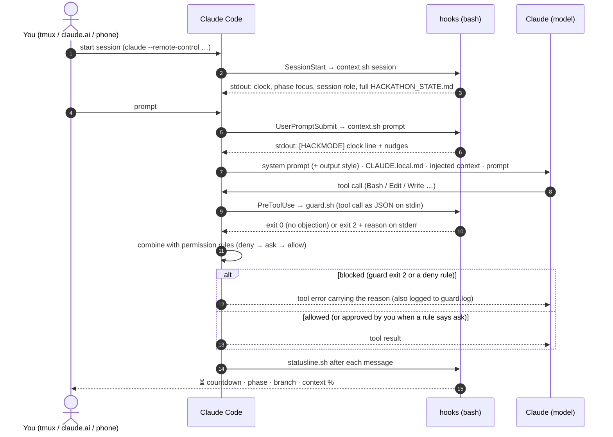
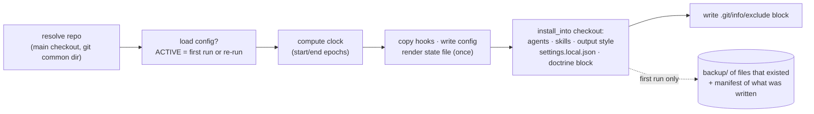
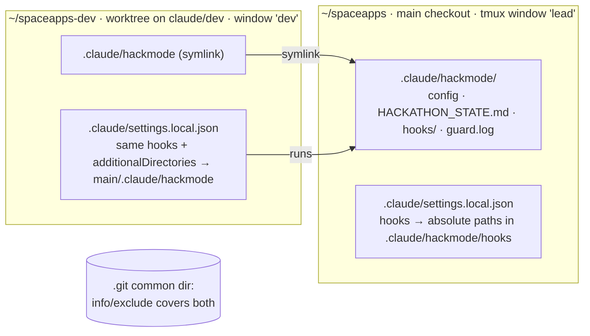

# Architecture

## What a "mode" is

A mode is configuration, not a program. Claude Code already has extension points: memory files, output styles, hooks, permission rules, subagents and skills. A mode fills each one with content for a specific situation, installs it into a repo, and can remove it again. The scripts (`hackmode.sh`, `hackmode.bat`) are installers. Once installed, Claude Code itself runs the mode.

## The six layers

| # | Layer | Answers | Claude Code mechanism | hackathon mode files |
|---|---|---|---|---|
| 1 | **Persona** | How should Claude think and talk? | Output style (part of the system prompt) | `template/output-styles/hackathon.md` |
| 2 | **Doctrine** | What are the rules here? | Memory file `CLAUDE.local.md` (loaded every session) | `template/doctrine.md` |
| 3 | **Anchor** | What is the situation right now? | `SessionStart` + `UserPromptSubmit` hooks (their stdout becomes context) reading a state file | `hooks/context.sh`, `HACKATHON_STATE.md`, `config` |
| 4 | **Delegation** | Who does specialised work? | Subagents (`.claude/agents/`), skills (`.claude/skills/`) | `template/agents/*.md`, `template/skills/*/SKILL.md` |
| 5 | **Enforcement** | What must never happen? | Permission rules + a `PreToolUse` hook that blocks with exit code 2 | `template/settings.local.json`, `hooks/guard.sh` |
| 6 | **Visibility** | What does the human see? | Status line command | `hooks/statusline.sh` |

**Soft vs. hard controls.** Layers 1–4 are instructions, so the model can still misjudge. Layer 5 is enforced by Claude Code whatever the model wants. Anything that must *never* happen therefore belongs in layer 5, and everything else in the doctrine. The guard is also written to steer the model: each block says what to do instead and tells Claude not to retry variants.

**Where each layer reaches.**

| | main session | subagents (`.claude/agents`) | forked skills (`context: fork` + `agent:`) |
|---|---|---|---|
| Output style | ✅ | ❌ they run their own system prompt (the agent file) | ❌ (same as subagents) |
| `CLAUDE.local.md` | ✅ | normally receive project memory (the docs list an `omitClaudeMd` field to opt out) | as subagents |
| Clock/state hooks | ✅ injected per prompt | ❌ not injected | ✅ via the skill's `` !`context.sh brief` `` line |
| Guard + permissions | ✅ | ✅ hooks also run inside subagents | ✅ |

That's why every agent file restates its key rules (ignore style, budget, team language), and why forked skills inject the clock and state themselves.

## Runtime flow

Two things make the anchor work:
- **The clock is computed, not remembered.** `config` stores the start and end as epoch seconds. Each hook call computes the time left, the % elapsed and the phase, so the model never has to track time.
- **The state is a file, not chat history.** `HACKATHON_STATE.md` survives `/clear`, compaction, new sessions and parallel sessions. `/state` edits it and mirrors it to a pinned GitHub issue for the team. The prompt hook nudges when it's stale (≥3 h), when the challenge is still `[TBD]` after IDEATE, and when the phase changes.

Phases are percentages of the event, so the same model fits a 24 h or 48 h event: IDEATE <10 % · BUILD <55 % · INTEGRATE <80 % · FREEZE <92 % · SUBMIT <100 % · OVER.

## Install lifecycle

`off` runs it in reverse:
1. Remove the dev worktree. It is kept if it has uncommitted work, unless you pass `--force`.
2. Archive the state file and guard log to `~/.hackmode/archive/`.
3. Delete the files listed in the manifest and restore the backups.
4. Strip the doctrine block from `CLAUDE.local.md`. Your own content stays; the file is deleted only if nothing else is left.
5. Delete `.claude/hackmode/` and the directories left empty.
6. Strip the exclude block.

Everything is idempotent: re-running `on` refreshes the templates and keeps the state file, the clock and the original backups.

## Git hygiene

Nothing hackmode writes is ever committed:
- `CLAUDE.local.md` is the local memory file Claude Code loads alongside any team `CLAUDE.md`. Using it means the team's file is never modified and `git pull` never conflicts with it.
- Every installed path is listed between markers in `.git/info/exclude`. That file lives in the git *common* dir, so it covers all worktrees and never shows up in `git status`.
- The guard blocks `git add -A` / `git add .`, so Claude stages explicit paths.

## Parallel sessions

- **One clock and one state for every session.** The dev worktree's `.claude/hackmode` is a *directory* symlink to the main one. Atomic file rewrites (temp file + rename) still land in the real directory, so they can't break the link.
- **Hooks find their home from their own location** (`$(dirname $0)/..`). The same scripts serve both checkouts.
- **Roles.** The `SessionStart` hook tells each session whether it is LEAD or DEV, and the doctrine says to switch branches only in your own checkout.
- **feature-builder** subagents run with `isolation: worktree`. Claude Code creates and cleans up those worktrees under `.claude/worktrees/`, which is also git-excluded.

## Cross-platform model

| | Linux / macOS | Windows |
|---|---|---|
| Installer | `hackmode.sh` (bash) | `hackmode.bat` (batch) + `lib/hackmode-win.ps1` (date math, UTF-8 text edits) |
| Hooks / status line | bash | **the same bash scripts**: Claude Code runs hook commands through Git Bash on Windows |
| Hook paths in settings | `bash '/abs/path/hooks/guard.sh'` | `bash 'C:/abs/path/hooks/guard.sh'` (forward slashes) |
| tmux war room, dev worktree | ✅ | ❌ |

The hooks are dependency-free (bash + grep + sed + git: no jq or Python), so one implementation serves both OSes. The installer is the part that's duplicated. That's the main argument for a future Python port ([roadmap.md](roadmap.md)).
