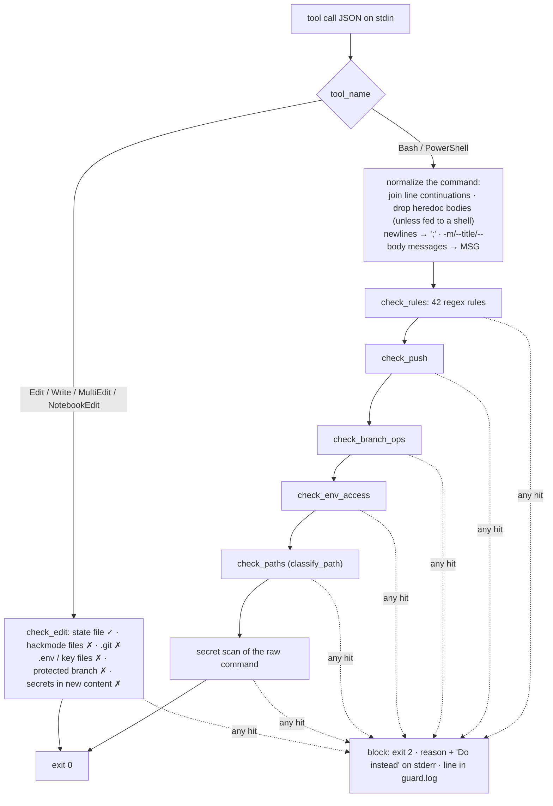

# Code structure

## Repository

```
claude-devmode-configurator/
├── hackmode.sh                  installer/CLI for Linux & macOS (bash, ~480 lines)
├── hackmode.bat                 installer/CLI for Windows (batch, ~330 lines, CRLF)
├── lib/hackmode-win.ps1         helper hackmode.bat calls for date math and UTF-8 text edits (ASCII-only)
├── template/                    the hackathon mode: everything copied into a target repo
│   ├── doctrine.md              → CLAUDE.local.md (managed block)
│   ├── output-styles/hackathon.md
│   ├── settings.local.json      → .claude/settings.local.json (placeholders filled at install)
│   ├── HACKATHON_STATE.md       → .claude/hackmode/HACKATHON_STATE.md (rendered once)
│   ├── agents/                  5 subagents
│   ├── skills/                  7 skills (one folder each, SKILL.md)
│   └── hooks/                   → .claude/hackmode/hooks/
│       ├── lib.sh               shared: config, clock/phases, path + JSON helpers
│       ├── context.sh           SessionStart / UserPromptSubmit / skill injection
│       ├── guard.sh             PreToolUse guard
│       └── statusline.sh        status line
├── tests/
│   ├── guard_test.sh            160 allow/block cases for guard.sh
│   └── e2e_test.sh              on → re-run → clock → tmux → status → off, 32 checks
├── docs/                        you are here
└── .gitattributes               LF for .sh (hooks run in Git Bash), CRLF for .bat/.ps1
```

The code splits into an **engine** (installer + hooks: the mechanism) and **mode content** (`template/` minus `hooks/`: the hackathon-specific text). The split isn't clean yet: a few hackathon strings live in the engine. [creating-a-mode.md](creating-a-mode.md) lists them.

## `hackmode.sh`

Uses `set -euo pipefail`, and sources `template/hooks/lib.sh` so the installer and the hooks share one clock/phase implementation.

| Area | Functions | Notes |
|---|---|---|
| CLI | `main`, `parse_opts`, `usage` | `--opt=value` and `--opt value`; `--` passes the rest to `claude` |
| Repo | `resolve_repo`, `load_cfg`, `default_branch` | always targets the **main** checkout (first entry of `git worktree list`); refuses paths containing `' " \ # &` |
| Clock | `compute_clock`, `to_epoch`, `human_time` | `--deadline` alone keeps the start; `--start` alone keeps the length; dates use `LC_ALL=C` |
| Config & state | `write_config`, `render_state`, `update_state_deadline`, `sed_esc` | the state file is rendered once and never overwritten; only its Deadline line is updated |
| Installing | `install_into`, `put`, `write_doctrine` / `unwrite_doctrine` / `strip_block`, `write_exclude` / `strip_exclude` | `put` = copy + record in the manifest, plus a one-time backup on the first `on` |
| Commands | `cmd_on`, `cmd_off`, `cmd_status`, `cmd_clock`, `cmd_state`, `cmd_claude`, `cmd_tmux`, `cmd_install` | |
| Helpers | `remove_installed`, `rmdir_empty`, `preflight`, `autonomy_note`, `self_name`, `setup_dev`, `claude_args`, `tmux_attach` | `claude_args` maps autonomy → CLI flags and adds `--remote-control <repo>-<role>` when `claude --help` lists it |

Environment overrides (used by the tests): `HACKMODE_CLAUDE` (claude binary), `HACKMODE_TMUX_SESSION` (default `spaceapps`), `HACKMODE_NO_ATTACH=1`.

## Hooks (`template/hooks/`)

Each hook sets `HM_HOME` to its parent directory, sources `lib.sh` and reads `HM_HOME/config`. They never source or eval the config: it's parsed line by line.

### `lib.sh`
| Function | Purpose |
|---|---|
| `hm_load_config` | reads the known `HACK_*` keys; fails if the start/end epochs are missing |
| `hm_clock` | sets `HM_NOW HM_LEFT HM_PCT HM_PHASE HM_HINT HM_NEXT HM_NEXT_AT` (the phase model lives here) |
| `hm_clock_line` | the `[HACKMODE] … phase BUILD (INTEGRATE in 9h40m)` line |
| `hm_dur`, `hm_mtime` | `31h05m` formatting; file mtime on GNU and BSD |
| `hm_normpath` | `\` → `/`, `/c/x` → `c:/x` on Git Bash, lowercase drive letter (for Windows comparisons) |
| `json_str KEY` | first JSON string value of `KEY` in `$INPUT`, unescaped, via a bash regex. Enough for Claude Code's flat hook payloads; not a general JSON parser |

### `context.sh <session|prompt|brief>`
- `session` (SessionStart): header, clock, phase focus, session role (LEAD/DEV), team language, then the full state file, capped at 8 000 bytes (Claude Code caps hook context at 10 000 characters).
- `prompt` (UserPromptSubmit): the clock line, plus nudges: phase change (tracked in `.phase`), state older than 3 h, challenge still `[TBD]` after IDEATE, under 1 h left.
- `brief` (skills, agents): clock + focus + state. It doesn't read stdin, so it can't hang inside a skill's `` !`…` `` injection.

It always exits 0, so it can never block a prompt.

### `guard.sh`



| Function | What it checks |
|---|---|
| `check_rules` | privilege (`sudo`, `su`), disks/power, fork bomb, `kill -1`, recursive chmod on `/`/`~`, download-to-shell, `reset --hard`, `clean -f`, history rewrites, `git add -A/./--all`, `commit -a`, deleting protected branches, `gh pr merge` / repo delete or edit / secrets / auth token / API DELETE, docker prune / host-root mounts, package publishing, credential stores, env dumps, writes to system files, edits to hackmode's own files |
| `check_push` | per `git push`: force flags and `+refspec`, `--mirror/--all/--prune`, protected destinations (including the implicit current branch), remote deletes allowed only for `claude/*` |
| `check_branch_ops` | `commit/merge/rebase/cherry-pick/revert/am` while on a protected branch, or right after switching to one |
| `check_env_access` | a `.env*` file (not `.example/.sample/.template/.dist/.defaults/.schema`) combined with a reader (`cat`, `grep`, `source`, `curl`, interpreters…), `@.env` uploads, or `git add`. `--env-file` arguments are ignored |
| `check_paths` | per simple command: tracks `cd`; classifies `rm`/`rmdir`/`unlink`/`shred`/`Remove-Item`/`del`/`rd` targets, `mv` sources and `find … -delete` roots |
| `classify_path` | → `ok` (inside the project) · `tmp` · `cwd` (`.`, `*`, the project root) · `root` · `home` · `parent` (`..`) · `git` · `var` (unexpanded `$X`, `$(…)`) · `outside` |
| `find_secret` | one `grep -E` pass for AWS/GitHub/Slack/Google/Stripe/`sk-` keys, private keys and `api_key=<30+ chars>`; for file writes, also `password/secret/api_key = "…"` literals. Placeholders (`your`, `example`, `demo`, `<…>`…) are ignored; only the first 4 characters are ever echoed |
| `check_edit` | file-path policy + the branch rule (`git symbolic-ref` of the nearest existing directory) + secrets in `content`/`new_string`/`new_source` (`old_string` ignored, so removing a secret works) |

Regex building blocks: `CB` = start of a simple command, after optional wrappers (`env`, `nohup`, `timeout 30`, `FOO=1`…). Using it means `echo "use sudo"` doesn't trigger the sudo rule. `B` = any word boundary; `E` = end of a word; `G` = `CB` + `git` + global options (`-C dir`, `--no-pager`…).

### `statusline.sh`
Reads the status-line JSON (`workspace.current_dir`, `model.display_name`, `context_window.used_percentage`) with `json_str` and prints one line. The phase is colour-coded and a protected branch is shown in red with "(no edits)".

## Windows (`hackmode.bat` + `lib/hackmode-win.ps1`)

`hackmode.bat` mirrors `hackmode.sh`'s `on/off/status/clock/state/claude`. Labels: `:resolve :loadcfg :protected :clock_compute :write_config :install_into :put :backup :exclude_add :archive :preflight :find_bash`. It does argument parsing, git calls, copying, manifest/backup and launching itself. It calls the helper (`powershell -NoProfile -ExecutionPolicy Bypass -File lib\hackmode-win.ps1 <verb> …`) for:

| Verb | Job |
|---|---|
| `now`, `stamp`, `epoch`, `human` | epoch math and `YYYY-MM-DD HH:MM` parsing (invariant culture) |
| `config`, `state`, `set-deadline`, `render` | UTF-8 (no BOM, LF) writes of config, state and settings |
| `doctrine`, `undoctrine` | insert/remove the managed block in `CLAUDE.local.md` |
| `exclude-add`, `exclude-remove` | the `.git/info/exclude` block |
| `status`, `cat` | status report (same phase model) and UTF-8-safe printing |

Batch arithmetic is 32-bit, which is fine for epochs until 2038. Batch files need CRLF line endings, enforced by `.gitattributes`.

## Templates and placeholders

| File | Placeholders | Filled by |
|---|---|---|
| `settings.local.json` | `__HOOKS__` (absolute, forward slashes), `__ADDITIONAL_DIRS__` (`[]`, or `["<main>/.claude/hackmode"]` in the dev worktree) | `install_into` / `render` |
| `HACKATHON_STATE.md` | `__EVENT__ __DEADLINE__ __HOURS__ __LANG__ __NOW__` | `render_state` / `state` |
| `doctrine.md` | none (it *is* the block between `<!-- hackmode:start … -->` and `<!-- hackmode:end -->`) | `write_doctrine` / `doctrine` |

## What gets installed into a target repo

```
<repo>/
├── CLAUDE.local.md                    doctrine block on top; your own notes kept below it
├── .claude/
│   ├── settings.local.json            outputStyle · permissions (113 allow / 61 deny) · hooks · statusLine
│   ├── output-styles/hackathon.md
│   ├── agents/  scope-guard · crash-reviewer · nasa-data-wrangler · feature-builder · pitch-writer
│   ├── skills/  pivot-check · triage · review-pr · build · data · pitch · state
│   └── hackmode/
│       ├── config                     KEY=VALUE (below)
│       ├── HACKATHON_STATE.md         the anchor: the only file here Claude may edit
│       ├── hooks/                     lib · context · guard · statusline
│       ├── manifest                   absolute paths of every file written
│       ├── backup/ (+ index)          files that existed before the first `on`
│       ├── guard.log                  TSV: time · tool · reason · snippet (secrets redacted)
│       └── .phase                     last phase seen (for phase-change nudges)
└── .git/info/exclude                  "# >>> hackmode … >>>" … "# <<< hackmode <<<"
<repo>-dev/                            Linux only (tmux): worktree on claude/dev, .claude/hackmode → symlink
```

`config` keys: `HACK_VERSION HACK_EVENT HACK_START HACK_END` (epochs) `HACK_END_HUMAN HACK_HOURS HACK_LANG HACK_AUTONOMY HACK_PROTECTED_BRANCHES HACK_MAIN_ROOT`.
`backup/index` lines: `<key><TAB><original path>` (bash) or `<key>|<original path>` (batch). The key is the path with separators replaced.

## Tests

| Command | Covers |
|---|---|
| `bash tests/guard_test.sh` | 160 cases: shell rules, push/branch logic, `.env`, path classification, heredoc/message scrubbing, edits on main vs `claude/*`, secrets (incl. MultiEdit/NotebookEdit), PowerShell commands, a 1.5 MB write. Needs `python3` (only to build JSON payloads) |
| `bash tests/e2e_test.sh` | full lifecycle in a sandbox `HOME` with a bare origin, a team `CLAUDE.md`, pre-existing personal files, a fake `claude` and a real tmux server |
| `claude doctor` (in an installed repo) | Claude Code accepts the generated settings (no API call) |
| `claude -p --model haiku --max-budget-usd 0.25 "…"` | live smoke test: the clock line is in context, the guard blocks a commit on main, the output style is active, a forked skill runs |

`hackmode.bat` and the PowerShell helper have **not** been executed (no Windows machine was available); see [roadmap.md](roadmap.md).
